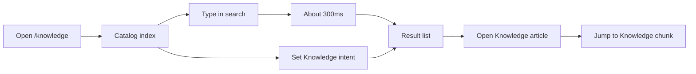

# Design Spec: Knowledge catalog

Visual redesign of the public Knowledge catalog on the Kit site. Behavior stays. The reader still
searches, filters by Knowledge intent, opens a Knowledge article, and jumps to a Knowledge chunk.
Ops CMS is out of this surface.

Reviewed live on 2026-10-27 at `https://ai-kit.polyms.dev/knowledge`,
`https://ai-kit.polyms.dev/knowledge/KN-001`, and a missing id, in dark, at 1280×800 and 390×800.
Home screen is the visual neighbor and is not restyled.

## 0. Redesign audit

### 0.1 Shipped vs intent

**Shell.** Shipped as an `h-dvh` row. The rail is `w-full` until `lg`, so at 390px the article
pane is a dark strip beside the rail. That misses §B asymmetry: the reading column is an empty
band. Stack under `lg`. The rail is on top (46dvh, its own scroll) and the pane is below. From
`lg`, the rail is 22rem (about 28% at 1280) and the pane is the rest.

**Rail.** The title is an `h1` at `text-2xl`. Search is a full pill. Intent is four `text-xs`
segments. Each article is an icon tile in a rounded row, and the active row is a filled peach
slab. That is §A icon-tile, and the pill fights the article title. The rail title is not a
heading. Search is a mono field on `bg-surface` with a real border. Intent labels stay `text-sm`
and wrap. Rows are type, not tiles. The active row is `item-primary` plus a 4px primary edge.

**Intro.** A centered book icon, a centered heading, and three equal bordered cards with icon
squares, in a large empty field. That is §A centered hero, equal card grid, icon tiles, and a
void. Use a left-aligned title and three stacked rows under the body (name, then description).
No icon, no All row, no card chrome.

**Article.** An id pill, an intent badge, a title that clips, hash pills, and a dashed checklist
card. The dashed card is §A card chrome, and the title scale fights the rail `h1` (two `h1`s).
One `h1` lives in the reading pane. Meta sits above the title. The checklist is a flat
edge-accent section, not a dashed card.

**Missing id.** A dashed box, with the sentence and the link centered in a tall void. The
sidebar stays. That misses §B designed empty space. Keep the copy, left-aligned where the title
would be. No dashed frame. The sidebar stays.

**Config block.** A `bg-slate-950` slab and a raw `button` pair, beside the Kit site terminal
strip. Use the terminal surface: `bg-surface`, `border-line`, `rounded-lg`. JSON/YAML uses
`Toggle`.

```text
[critical] Equal-height icon-tile cards — catalog index intro
  why: three identical bordered cards with an icon square are the 2018 feature grid
  → replace with three stacked rows under the intro body; no icons; no All row
[critical] Icon-tile result rows — catalog rail
  why: every article is icon square + title + two-line meta inside a rounded slab
  → title and meta only; 2px intent bar; active state is item-primary plus border-s-4
[major] Centered void — intro and missing id
  why: one line (or an icon plus a line) sits in the middle of an empty reading pane
  → left-align into the reading column; keep the shipped sentences
[major] Two competing h1s — rail title vs article title
  why: "Knowledge" and the article title are both h1, so the pane has no single focal beat
  → rail name is plain text; the reading pane owns the only h1
[major] Small-screen split — shell
  why: at 390px the rail consumes the width and the article pane is a blank column
  → stack rail over pane below lg
[minor] Dashed checklist and not-found frame — article
  why: dashed rounded boxes read as card soup on an otherwise flat Kit site
  → border-line seams and one border-s-4 accent

Summary — 2 critical · 3 major · 1 minor
Verdict — close, fix the critical and major tells; do not restyle the home screen
```

### 0.2 Preservation

Must not change:

- Routes: `/knowledge` (shell + rail), `/knowledge/` (intro), `/knowledge/$id` (article).
- Search params: `q`, `intent`. Chunk links add the chunk hash. `q` updates about 300ms after the
  last keystroke.
- Intent values: `incident`, `design`, `toolchain`. Toolbar All clears `intent`. There is no All
  card. Intro rows and the toolbar write the same `intent`. A row press keeps `q` and stays on
  the intro.
- Result rules: `results === undefined` is loading (skeleton rows, and the empty sentence is
  hidden). An empty array is no match. A chunk-only hit has no Knowledge article row. A dual hit
  nests the Knowledge chunk under the article. While a resolved list is merely refreshing
  (`isPending` with results still present), keep the rows and fade them. Do not swap that fade
  for the empty sentence.
- Article rules: id is plain text. Intent line is `Intent: Incident`, `Intent: Design`, or
  `Intent: Toolchain`. Title is the page heading. Axis tags only when present. Article checklist
  only when the article has one, and it is not a checklist Knowledge chunk. Chunk badge text is
  the uppercase of the existing labels: INCIDENT, SEAM, CONFIG, CHECKLIST, PROSE. JSON/YAML only
  when the config body parses as a JSON object or array, with `aria-pressed`. A `.yml` filename
  highlights YAML and does not show the switch. Cause, Fix, and Verify only on incident chunks,
  and only for non-empty lists. More than one chunk shows `Reading order` and `On this page`.
  One chunk omits that nav.
- Missing id replaces the article pane only. The rail stays. `Back to knowledge` goes to
  `/knowledge` with the default search (`q` empty, `intent` unset).
- No sign-in, no create, no update, no delete. No Ops CMS, no schema change, no new CMS, no MCP
  change, no analytics, no new Knowledge intent, no locale project. Do not edit the message
  catalog. Do not restyle `/` or the skill catalog. Do not add a second theme toggle. The Kit
  site theme toggle and locale toggle stay on the existing flyout.
- Strings that stay verbatim: `Search Knowledge by topic or symptom`, `biome prettier setup`,
  `Intent`, `All`, `Incident`, `Design`, `Toolchain`, `No Knowledge articles match your search.`,
  `Knowledge retrieval for agents`, `Pick an article from the list on the left to read it, or
  filter by intent below.`, `Deploy/CI symptom → cause → fix → verify.`, `Seams between stack
  choices — routing, state, modules.`, `Org-wide setup recipes — formatters, tooling.`,
  `Knowledge article not found.`, `Back to knowledge`, `Checklist`, `Cause`, `Fix`, `Verify`,
  `Reading order`, `On this page`, `Knowledge search results`, rail title `Knowledge`, and the
  rail subtitle `Incident · design · toolchain — one retrieval model for developer, /dev,
  /devops, /arch.`

### 0.3 Levers (visual only)

- Rail vs pane surfaces and the `lg` stack, so the Kit site seam language shows up here.
- Drop icon tiles and equal cards. Keep the three intents as rows.
- One heading in the reading pane. Meta, checklist, and chunks use the existing type classes.
- Map the JSON/YAML switch and the intent toolbar to `Toggle` / `Toolbar`. Map `On this page` to
  `Toc` when there is more than one chunk.
- Fill the pending reading pane with a skeleton so the first paint is not a void. Do not add a
  toast, a retry, or a new route.

No new ADR. Stack stays ADR-0002: Vite, React, `@polyms/ui-kit`, TanStack Router, filters in
search params, dark default plus the existing light toggle, Quicksand and JetBrains Mono.

## 1. Brief

| Dimension | Question | This catalog |
| --- | --- | --- |
| Industry | What world is the user in? | Developer tools. Published Knowledge on the Kit site. |
| Audience | Who judges "good" in 3 seconds? | Signed-out engineer. They scan a list, then read. |
| Mood | One adjective + one anti-mood | Engineering artifact. Not a docs theme, not a second product. |
| Motion depth | subtle / standard / emphasis | Subtle. Color and opacity only. No hero motion. |
| Layout family | Pick one primary family | Sticky tool rail + reading column. Not a centered hero. |
| Focal moment | One viewport = one hero beat | Intro title, or the article title. The rail is a tool. |
| Density | sparse / balanced / dense | Balanced-dense. Tight rows. The column is for reading, not a void. |
| Theme default | dark-first / light-first / system | Dark-first. Existing light toggle. Tokens only. |
| Reference tier | What "good" looks like | Kit site home, tasteskill.dev density. Do not clone a brand. |

**Brief lock.** The public catalog is the Kit site's reading room for published Knowledge. Success
is a dark rail the reader can scan, and a reading column whose title is the only loud type, with
the same search, Knowledge intent filter, list, and article the catalog already ships.

**Assumptions (collab, ask gate already clear).** Visual redesign only. English story strings stay
verbatim. Intro rows and the sidebar toolbar remain two controls for one `intent`. The shipped
catalog has no separate index error screen, no sign-in wall, and no retry of Ops CMS. No blocking
fork. No new ADR.

## 1b. Quality bar

- **Visual reference:** [Kit site home](https://ai-kit.polyms.dev/) — borrow full-bleed dark
  canvas, `border-line` seams, `border-s-4` accent, Quicksand + JetBrains Mono. Avoid restyling
  that page, and avoid its hero terminal on this route.
  [tasteskill.dev](https://www.tasteskill.dev/) — borrow craft density only. Avoid its brand
  colors and any marketing section inventory.
- **Craft intent:** Reading title 24px, 30px from `md`. Chunk titles 18px. Body 14px. Meta
  `.label-mono` at 12px. Rail `bg-surface`, pane `bg-body`, one `border-line` seam. Rail 22rem
  from `lg` (~28% at 1280). No `rounded-xl` on rows, checklist, or the not-found block.
- **DNA notes:** Layout family is rail + column (home is hero + rail; this route keeps the rail
  and drops the hero). Type roles are title / chunk / body, with mono for the search field, ids,
  config, and `.label-mono`. Colour anchor is `primary-700` on the active edge and the intent
  badge, plus the existing danger / info / warning tones for the three Knowledge intents.

### Section rhythm

This is one app shell, not a marketing page. No alternating full-bleed bands.

| Region | Width | Surface |
| --- | --- | --- |
| Shell | Full viewport, `100dvh`, no `max-w-6xl` | `bg-body` |
| Rail | 46dvh below `lg`; 22rem from `lg` | `bg-surface`, seam `border-line` |
| Reading column | Fluid remainder, padding `.page-x` | `bg-body` |
| Intro stack | `max-w-xl`, start-aligned | No card surface |
| Article column | `max-w-3xl`; toc adds `14rem` from `xl` | Seams, not cards |
| Config block | Full width of the chunk | `bg-surface` + `border-line` |

### Primary viewport (no marketing hero)

There is no landing hero on this route. The first screen of the reading column is the focal beat.

At `lg` (1280), the reader sees this without scrolling the pane:

```text
┌ rail 22rem · 28% ──────────┬ reading · 72% · bg-body ─────────────────────┐
│ Knowledge                  │ Knowledge retrieval for agents     .knowledge-title
│ subtitle (2 lines, muted)  │ Pick an article from the list on the left…   │
│ [ mono search field      ] │ ───────────────────────────────────────────── │
│ All  Incident  Design  …   │ Incident   Deploy/CI symptom → cause → …     │
│ ────────────────────────── │ Design     Seams between stack choices — …   │
│ article title              │ Toolchain  Org-wide setup recipes — …        │
│ meta · match               │                                              │
│   chunk title              │                                              │
│ polyms wordmark            │                                              │
└────────────────────────────┴──────────────────────────────────────────────┘
```

Below `lg` the same blocks stack: rail first (search, intent, a short result scroller), then the
reading column. The intro sentence still says "on the left". Do not rewrite it.

## 2. Flows

### Primary flow



### Critical paths

- Happy path: index, optional `q` and `intent`, open a title, land on `/knowledge/$id` with `q`
  and `intent` kept, jump with the chunk hash.
- Chunk-only hit: the list shows the chunk with no article row. The link still opens the article
  at that hash.
- Dual hit: the chunk is nested under its article.
- No match: the list shows only `No Knowledge articles match your search.` The intro stays.
- Loading: skeleton rows. The empty sentence is absent.
- Intro row: sets `intent`, keeps `q`, stays on the intro. Toolbar All clears `intent`.
- One chunk: no `On this page` nav. The chunk section still renders.
- Missing id: pane shows `Knowledge article not found.` and `Back to knowledge`. The rail stays.
- Refresh of an existing list: rows stay, faded. They do not become the empty sentence.

## 3. Screen inventory

The shell (rail + reading pane) is on every `/knowledge` URL. Screen 1 is the index route. Screen
2 replaces the reading pane on `/knowledge/$id`. The rail's loading and empty rules are the same
on both screens.

### Catalog index

| Field | Value |
| --- | --- |
| Goal | Search Knowledge, narrow by Knowledge intent, or stay on the intro. |
| Entry | `/knowledge` or `/knowledge/` with optional `q` and `intent`. |
| Exit | A result opens an article. The wordmark goes to `/`. A row stays here. |

**Content states:**

| State | User sees | Action available |
| --- | --- | --- |
| Loading | Six skeleton rows. No empty sentence. | Search and intent stay usable. |
| Empty | The empty sentence only, in the list. Intro stays. | Change `q` or `intent`. |
| Error | No index error surface. See below. | Keep using the rail. |
| Success | Article rows, nested chunks, and the intro. | Open a row, or set an intent. |

Loading detail. The skeleton list is `role="status"` and its name is `Knowledge search results`.
If the layout itself is pending, the reading pane is a title bar and two chunk seams in
`.skeleton`, not the intro copy. A refresh that still has results keeps those rows at 60%
opacity.

Empty detail. The sentence is `No Knowledge articles match your search.`, left-aligned, with a
2px `border-line` edge. No icon. No second sentence. Intro rows still set `intent`.

Error detail. The shipped catalog has no index error surface. An unresolved list
(`results === undefined`) uses the loading row. Do not add a toast, an `Alert`, a retry of Ops
CMS, or a new route.

**Intro, success.** Start-aligned. `pt-10`, horizontal padding `.page-x`, stack `max-w-xl`.

- The only `h1`: `Knowledge retrieval for agents`, class `.knowledge-title`.
- Body, `text-sm text-muted`, max about 65 characters per line: `Pick an article from the list on
  the left to read it, or filter by intent below.`
- Three rows, no All row. Each row is a link. Left column 7rem: `Incident`, `Design`, or
  `Toolchain` (`text-sm font-semibold`). Right column: the matching description, `text-sm
  text-muted`. Row separator `border-b border-line`. The row whose value equals `intent` gets
  `border-s-4 border-primary-700` and `item-primary` plus `active`. No row is active when
  `intent` is unset.
- No icon square, no `rounded-2xl`, no equal-height grid.

**Rail, all states.**

- Name `Knowledge` is a `p` at `text-sm font-semibold`, not a heading. Subtitle is `text-sm
  text-muted`, two lines max, then it wraps.
- Search: `Field` named `knowledge-search`. Label is visually hidden and the control's accessible
  name is `Search Knowledge by topic or symptom`. Placeholder `biome prettier setup`.
  `type="search"`, `autoComplete="off"`, `font-mono text-sm`. Classes: `bg-surface border
  border-line rounded-md min-h-11`, not a pill, not `border-none`. Magnifier is `aria-hidden`,
  inside the start padding. Debounce stays 300ms.
- Toolbar `aria-label="Intent"`, `variant="inline"`. `ToggleGroup` `aria-label="Intent"`, value
  is `intent` or `all`. Buttons: `All`, `Incident`, `Design`, `Toolchain`. Labels are `text-sm`.
  The group wraps to two rows rather than shrinking to `text-xs`. Pending sets the toolbar to
  `opacity-60`. It does not disable the toggles.
- List region scrolls inside the rail. Article row: title `text-sm font-semibold` truncated, meta
  `text-xs text-muted` truncated, reading `{Intent label} · {match}`. A 2px bar on the start edge
  uses the existing intent tones: incident `bg-danger-600`, design `bg-info-600`, toolchain
  `bg-warning-600`. No book icon. Current article: `item-primary` + `active` + `border-s-4
  border-primary-700`. Nested chunks sit in a `border-s border-line` list, `text-xs`, with no
  article row when the hit is chunk-only. Chunk link sets the hash. Title links keep `q` and
  `intent`.
- Wordmark: existing Polyms wordmark, link to `/`, pinned to the bottom of the rail on `lg`. On
  the stacked rail it sits under the result scroller, still inside the rail.

```text
lg rail (22rem)
┌────────────────────────────┐
│ Knowledge                  │
│ Incident · design · …      │
│ ┌────────────────────────┐ │
│ │ biome prettier setup   │ │  font-mono, border-line
│ └────────────────────────┘ │
│ [ All ] [ Incident ]       │
│ [ Design ] [ Toolchain ]   │  wraps, text-sm
│ ────────────────────────── │
│ ▌ Article title            │  2px intent bar
│   Toolchain · match        │
│   │ chunk title            │  nested only on a dual hit
│ ────────────────────────── │
│ polyms                     │
└────────────────────────────┘
```

### Article

| Field | Value |
| --- | --- |
| Goal | Read one Knowledge article in reading order and jump to a Knowledge chunk. |
| Entry | A rail link to `/knowledge/$id`, optionally with a hash, keeping `q` and `intent`. |
| Exit | Another rail link, a chunk hash, the wordmark, or `Back to knowledge` from the missing state. |

**Content states:**

| State | User sees | Action available |
| --- | --- | --- |
| Loading | Rail skeletons, plus a title bar and two seams. | Search and intent stay usable. |
| Empty | Identity only. No `On this page`. No search sentence. | Use the rail to open another article. |
| Error | `Knowledge article not found.` and `Back to knowledge`. | Back, or keep using the rail. |
| Success | Identity, optional checklist, chunks, toc if needed. | Jump to a chunk, or search from the rail. |

Loading detail. Same rail rule as the index. The reading skeleton does not show the not-found
sentence or the empty sentence.

Empty detail. A resolved article with no chunks still shows identity and omits `On this page`.
One chunk is success without that nav, not this empty row.

Error detail. The sentence is `text-base text-fg`. The link is `.link.link-primary`. Both sit
left-aligned at the title position. No dashed box. The rail stays, including its current
results. `Back to knowledge` goes to `/knowledge` with the default search.

**Identity.** Padding `.page-x`, `pt-8`.

- First line, not a heading: id as `.label-mono` plain text (not a link, not a button), then one
  `span.badge.badge-primary` whose text is `Intent: Incident`, `Intent: Design`, or `Intent:
  Toolchain`. The existing tuning icon may stay, `aria-hidden`, at 12px. Do not put this line
  beside the title as a hanging head. It sits above.
- `h1.knowledge-title` is the article title. It wraps. It does not clip.
- Axis tags, only when the article has them: `span.badge.badge-light.font-mono` reading `#{tag}`.
  Not links.

**Article checklist.** Only when the article checklist is non-empty. A `border-s-4
border-primary-700` block, `ps-4`, not a dashed card. The label is the word `Checklist` in
`.label-mono` (this is the product name, not an eyebrow on every section). Items use the existing
check icon, `aria-hidden`, and `text-sm`. This block is not a checklist Knowledge chunk.

**Chunks.** Each chunk is a `section` with `id` equal to its slug, separated by `border-t
border-line` and `pt-8`. Heading is `h2` at `.knowledge-chunk-title` (the chunk title). On the
same row, end-aligned: optional filename as `span.badge.badge-light.font-mono`, then
`span.badge.badge-light.font-mono.uppercase` so the visible badge is INCIDENT, SEAM, CONFIG,
CHECKLIST, or PROSE. Source strings stay the existing labels. Do not invent new badge words.

- Prose and seam bodies: existing markdown map. Body `text-sm leading-relaxed`. Links
  `.link.link-primary`. Tables use `.table`. Inline code `font-mono text-xs` on `bg-surface`.
- Config: the switch is a `ToggleGroup` (`aria-label` not required beyond the two pressed
  buttons) of two `Toggle`s labeled `json` and `yaml`, each with `aria-pressed`. It renders only
  when the body parses as a JSON object or array. The pressed toggle matches the visible mode.
  The pre block is `.knowledge-config`: `bg-surface border border-line rounded-lg p-4 font-mono
  text-xs overflow-x-auto`. Syntax colors stay the existing semantic token classes
  (`text-primary-300`, `text-danger-300`, `text-warning-300`, `text-success-300`,
  `text-slate-500`). No `bg-slate-950`, no raw `button`, no hex.
- Incident: a definition list. `Cause`, `Fix`, and `Verify` are `.label-mono`, and each list
  renders only when non-empty. Verify items are `font-mono text-xs`.
- Checklist chunk: the chunk's own items, under the chunk heading, in a `divide-y divide-line`
  list. Do not wrap them in the article checklist's accent block. Do not merge the two lists.

**Reading order.** Only when `chunks.length > 1`.

- From `xl`: a 14rem column, sticky to the top of the scrolling pane. The reading column is
  `minmax(0, 48rem)`.
- Below `xl`: the nav sits after identity and the article checklist, before the first chunk, so
  the links are on screen without scrolling the whole article.
- The text `Reading order` is `.label-mono`, followed by the chunk count, as shipped
  (`Reading order · {n}`).
- The nav is `Toc` with `aria-label="On this page"`. Pass `scrollRef` pointing at the reading
  pane, because the pane scrolls, not the window. Each `Toc.Item` `href` is `#{slug}`. Include
  `Toc.Indicator`. One chunk: render none of this.

```text
xl article
┌ reading · max 48rem ──────────────────────┬ toc 14rem ─────────┐
│ KN-001          Intent: Toolchain         │ READING ORDER · 8  │
│ Biome + Prettier — Polyms default         │ ▌ biome.json       │
│ #typescript  #biome                       │   Setup checklist  │
│ ▌ Checklist                               │                    │
│   item                                    │                    │
│ ───────────────────────────────────────── │                    │
│ biome.json                          CONFIG│                    │
│ { config on bg-surface }            json  │                    │
└───────────────────────────────────────────┴────────────────────┘
```

## 4. Typography and visual system

`/dev` adds the classes below before rewiring the screens. Reuse `.h1` only if a call site still
needs it elsewhere. This route does not use `.display`. Fonts stay the Kit site pair: Quicksand
for interface text, JetBrains Mono for `font-mono` and `.label-mono`.

### Type scale

| Role | Class | Size | Weight |
| --- | --- | --- | --- |
| Reading title | `.knowledge-title` | 24px, 30px from `md` | 700 |
| Chunk title | `.knowledge-chunk-title` | 18px | 600 |
| Body | `text-sm leading-relaxed` | 14px | 400 |
| Rail name, row title | `text-sm font-semibold` | 14px | 600 |
| Meta | `.label-mono` (existing) | 12px, uppercase, tracking wide | 400 |
| Search, config, verify | `font-mono text-sm` or `text-xs` | 14px / 12px | 400 |

```css
@layer components {
  .knowledge-title {
    @apply font-bold text-2xl tracking-tight md:text-3xl;
  }
  .knowledge-chunk-title {
    @apply font-semibold text-lg tracking-tight;
  }
  .knowledge-shell {
    @apply flex h-dvh flex-col overflow-hidden bg-body;
  }
  .knowledge-rail {
    @apply flex h-[46dvh] min-h-64 w-full shrink-0 flex-col overflow-hidden border-line border-b bg-surface;
  }
  .knowledge-reading {
    @apply min-h-0 min-w-0 flex-1 overflow-y-auto bg-body;
  }
  .knowledge-intent-row {
    @apply grid grid-cols-[7rem_minmax(0,1fr)] gap-4 border-line border-b py-3.5 text-sm;
  }
  .knowledge-config {
    @apply mt-3 overflow-x-auto rounded-lg border border-line bg-surface p-4;
    @apply font-mono text-xs leading-relaxed;
  }
}
```

From `lg` (`1024px`), `.knowledge-shell` is `flex-row`. `.knowledge-rail` is `h-full w-[22rem]
border-b-0 border-e`.

Article grid when the toc exists, from `xl` (`1280px`):

```css
.knowledge-article {
  display: grid;
  grid-template-columns: minmax(0, 48rem) 14rem;
  column-gap: 2.5rem;
  align-items: start;
}
```

Below `xl`, `.knowledge-article` is one column. The toc node is ordered before the chunk list
(after the checklist). Do not use `grid-cols-2` for this.

### Surfaces

| Token | Use |
| --- | --- |
| `bg-body` | Shell and reading pane |
| `bg-surface` | Rail, search field, config block, inline code |
| `border-line` | Rail seam, row rules, chunk rules, config border |
| `border-s-4 border-primary-700` | Active result row, active intro row, article checklist |
| `text-fg` / `text-muted` | Primary and secondary text |
| `text-primary-700` | Active row title, links |
| `bg-danger-600` / `bg-info-600` / `bg-warning-600` | 2px intent bar only |

No gradients, no `shadow-lg`, no `rounded-xl` on rows or sections, no raw hex, no `#000` / `#fff`
surfaces. Light mode uses the same tokens. Do not add a flash script. The Kit site root already
paints dark from the existing store before React hydrates.

### Borrow / avoid

| Borrow | Apply here |
| --- | --- |
| Home seam: `border-line` on a 1px edge | Rail edge, chunk rules, intro rows |
| Home accent: `border-s-4 border-primary-700` | Active row, active intent, article checklist |
| Home terminal: `bg-surface border border-line rounded-lg font-mono` | Config block |
| Home type: `.label-mono` for real section names | Checklist, Cause, Fix, Verify, Reading order |

Do not borrow the home hero, the pipeline, the principal grid, or a second theme control.

## 5. Component map

Primitives below are already imported on the Kit site (`Field`, `Toolbar`, `Toggle`,
`ToggleGroup`) or are in the ui-kit catalog the site is built with (`Toc`, `.badge`, `.skeleton`,
`.item-primary`, `.link`, `.table`). Do not add a parallel component set.

| UI element | Primitive | Notes |
| --- | --- | --- |
| Search | `Field` + `Field.Control` | See states below. |
| Intent | `Toolbar` + `ToggleGroup` + `Toggle` | See states below. |
| Intro row | Router `Link` + `item-primary` | Not a `Button`. |
| Article and chunk row | Router `Link` + `item-primary` | Current row uses `active`. |
| Wordmark | Existing wordmark link | Target `/`. Do not redraw it. |
| Intent, axis, badge, file | `span.badge` | Static. Not `item-*`. |
| Checklist mark | Existing check icon | `aria-hidden`. |
| JSON/YAML | `ToggleGroup` + `Toggle` | Labels `json` and `yaml`. |
| On this page | `Toc` + `Toc.List` + `Toc.Item` | Plus `Toc.Indicator`. |
| Back to knowledge | Router `Link` + `.link.link-primary` | Not a primary `Button`. |
| Loading rows | `.skeleton` | Six rail rows; pane seams if pending. |
| Markdown table | `.table` | Inside the chunk body only. |

Search states. Label is `sr-only`. Accessible name as in §3. Default: `bg-surface` and
`border-line`. Hover: no extra chrome. Focus-visible: the ui-kit field ring. Not disabled while
loading. No spinner in the field. No error or success chrome.

Intent states. `aria-label="Intent"` on the toolbar and the group. Each control is
`Toolbar.Button` with `render={<Toggle />}`. The pressed toggle is the current value (`all`
when `intent` is unset). Default, hover, focus-visible, pressed. Not disabled during pending.
No loading, error, or success chrome. Wrap. Do not drop to `text-xs`.

Intro row states. Default transparent. Hover and focus-visible: `item-primary`. Current intent:
add `active` and `border-s-4 border-primary-700`.

Result row states. Hover and focus-visible: `item-primary`. Current article: `active` plus
`border-s-4 border-primary-700`. Current chunk: `text-primary-700 font-semibold`.

Badge notes. `badge-primary` for the intent line. `badge-light font-mono` for tags, filename,
and chunk type. Chunk type also uses `uppercase`.

JSON/YAML states. `aria-pressed` follows the visible mode. Default, hover, focus-visible,
pressed. Not disabled. No separate loading state.

Toc notes. `aria-label="On this page"`. `scrollRef` is the reading pane. Absent when there is
one chunk.

Wordmark and back link. Focus-visible ring. The back link is not a filled button.

**Custom components.** None that need a new primitive. The shell, the result list, the intro
rows, the config highlighter, and the markdown body are layout and content. They compose the rows
above. No follow-up issue. Do not invent `KnowledgeCard`, `IntentChip`, or a second `Badge`
component.

## 6. Motion plan

| Transition | Trigger | Tier | Reduced motion |
| --- | --- | --- | --- |
| List opacity | `isPending` with rows still present | subtle, 150ms, to 60% | Instant opacity |
| Skeleton to rows | `results` becomes an array | subtle, 150ms opacity | Instant swap |
| Row and intent hover | Pointer | subtle, 150ms color | Instant color |
| JSON/YAML body | Pressed toggle | none | Instant text swap |
| Index to article | Route change | none | Instant. No shared move. |

No typing animation, no rail glow, no page transition.

## 7. Responsive and accessibility

| Topic | Decision |
| --- | --- |
| Breakpoints | Stack below `lg`. Row from `lg`. Toc grid from `xl`. |
| Focus order | Search, intent, results, wordmark, then the pane. |
| ARIA | Names in the list below. |
| prefers-reduced-motion | Every §6 row is instant. |
| Headings | One `h1`. Chunk titles are `h2`. Rail name is not a heading. |
| Contrast | `text-fg` and `text-muted` on `bg-body` and `bg-surface`. |
| Target size | Toggles and rows at least 32px tall. Intro rows are full width. |

Breakpoints. Below `lg` (1024): column stack, rail 46dvh with an internal scroller, pane fills
the rest. From `lg`: row, rail 22rem, pane fluid. From `xl` (1280): article grid
`minmax(0, 48rem)` plus a 14rem toc. Below `xl` the toc is a block above the chunks.

Focus order. Search field, then intent toggles (toolbar roving tabindex), then result links in
list order, then the wordmark, then the reading pane: intro rows, or chunk toggles and toc
links, or `Back to knowledge`. The id, badges, and title are not tab stops.

ARIA. Search name `Search Knowledge by topic or symptom`. Toolbar and toggle group `Intent`.
Skeleton list `role="status"` and name `Knowledge search results`. Toc `On this page`. JSON/YAML
toggles expose `aria-pressed`. Icons in the field, badges, and checklist are `aria-hidden`.

Contrast. Do not put muted text on a peach fill. The active row is a tint from `item-primary`,
not a solid `bg-primary-100` slab. Both themes use the same tokens.

## 8. Visual acceptance for `/dev`

**Reference:** [Kit site home](https://ai-kit.polyms.dev/) for seams, type pairing, and dark
canvas. [tasteskill.dev](https://www.tasteskill.dev/) for density only. Acceptance screenshots are
dark. Light is a second pass for token contrast, not the sign-off theme.

| Check | Pass when |
| --- | --- |
| Dark-first | Sign-off shots are dark. No new theme toggle. |
| Type scale | Title, chunk title, body, and `.label-mono` all show. |
| Surface rhythm | Rail `bg-surface`, pane `bg-body`, seam `border-line`. |
| Focal beat | Intro title, or the article title. One `h1`. |
| ui-kit | `Field`, `Toolbar`, `Toggle`, `Toc`. No raw inputs. |
| Anti-slop | No icon-card grid, no tiles, no centered void, no gradient. |
| Small screen | At 390px the pane is below the rail and readable. |
| Copy | §0.2 strings unchanged, including the "below" sentence. |
| Behavior | 300ms `q`. Empty, loading, and missing stay distinct. |

Dark-first detail. First paint follows the existing Kit site theme script.

Type scale detail. The rail name is `text-sm`, quieter than `.knowledge-title`.

Surface detail. The config block uses the rail surface. Not one flat background, and not a
dashed card.

Focal beat detail. On the index the three intents are rows under the title. The rail does not
compete with a second `h1`.

ui-kit detail. JSON/YAML is `Toggle` with `aria-pressed`. `On this page` is `Toc` only when
there is more than one chunk.

Anti-slop detail. No `rounded-xl` on every block. No invented counts. Failures use the §E
format.

Behavior detail. Chunk-only vs dual hit, the one-chunk toc, checklist vs checklist chunk, and
Cause / Fix / Verify still hold.

**P0 slices (order):**

1. `globals.css` classes in §4, and the shell stack at `lg`, before any feature restyle.
2. Rail: type, search field, wrapping intent toolbar, rows without icon tiles.
3. Intro rows, left-aligned, no cards.
4. Article identity, checklist edge, chunks, config surface, `Toc`.
5. Missing-id alignment and the pending skeletons.
6. Dark sign-off at 1280 and 390, then a light contrast check. Home screen untouched.

## 9. Pre-flight

Run of [PREFLIGHT.md](../../skills/design/PREFLIGHT.md):

### Spec completeness

- [x] Catalog index and Article each have loading, empty, error, and success
- [x] Primary controls note interaction states in §5
- [x] No TBD, TODO, or placeholder copy
- [x] Flows cover search, intent, list shape, intro, article, toc, and missing id
- [x] Open questions are §10. Assumptions sit in §1
- [x] No invented metrics

### ui-kit alignment

- [x] Interactive elements map to `@polyms/ui-kit` or to an existing utility (`span.badge`,
      `.skeleton`, `.item-primary`, `.link`)
- [x] No invented names that duplicate a primitive
- [x] Theme uses semantic tokens and the existing Kit site toggle
- [x] Catalog read from `.cursor/skills/ui-kit` and from imports already in `apps/landing`
- [x] §4 uses named tokens and existing font classes. No mid-spec hex

### Anti-slop

- [x] Brief table in §1
- [x] Visual reference and measurable craft in §1b
- [x] §4 names type, surfaces, and grids
- [x] §8 names checks and P0 order
- [x] §11 marks §A, §A2, and §B
- [x] Section rhythm and the primary viewport sketch are in §1b. Marketing hero is N/A because
      this route has no hero; the sketch is the catalog's first screen
- [x] Screen names are Catalog index and Article, using Knowledge, Knowledge article, Knowledge
      chunk, Knowledge intent, Kit site, and Ops CMS
- [x] Rail width is specified at `sm` / `lg` / `xl`, not a generic `grid-cols-2`

### Craft critique

| Axis | Score | Note |
| --- | --- | --- |
| Philosophy | 5 | Rail + reading column, same Kit site, no second product |
| Hierarchy | 4 | One title per pane; four type steps in §4 |
| Execution | 5 | §4 classes and §8 checks are enough to implement |
| Specificity | 5 | Live audit, PRD strings, and result rules are named |
| Restraint | 4 | No new chrome, no counts, eyebrows only on real labels |
| Consistency | 5 | Tokens, fonts, and toggles stay the Kit site's |

### Motion and accessibility

- [x] Each motion row has a reduced-motion fallback
- [x] Focus order is in §7
- [x] Missing id tells the reader to go back. The index has no error product; the loading rule is
      the documented substitute, and search stays available

### Handoff

- [x] Saved at `docs/design/knowledge-catalog.md`
- [x] Next step is `/dev`

### Visual acceptance

- [x] One focal beat per viewport, named in §1 and §8
- [x] Dark-first sign-off
- [x] Redesign audit includes the live screenshots described in §0, not only a code walk

## 10. Open questions

None. The PRD left no blocking fork. Default search for `Back to knowledge` stays `q` empty and
`intent` unset.

## 11. Anti-slop appendix

### §A

| ID | Apply / N/A | Note |
| --- | --- | --- |
| Centered hero + two buttons | Apply | Title and three rows. No hero CTAs. |
| Equal-height card grid | Apply | Intro rows stack. Not three equal cards. |
| Icon-tile feature cards | Apply | No icon squares on rows. |
| Rounded card on every block | Apply | Seams, plus one accent edge. |
| Card-in-card | Apply | Checklist chunk is a list, not a nested card. |
| `max-w-6xl` everywhere | Apply | Full-bleed shell. Intro `max-w-xl`. Article `max-w-3xl`. |
| Purple or blue gradient hero | Apply | No gradient. |
| Aurora, mesh, or orbs | Apply | None. |
| Wall of text in a void | Apply | Intro, empty, and missing id are left-aligned. |
| Light gray on white only | Apply | Dark-first. Light uses the same tokens. |
| Mono with no size contrast | Apply | Meta 12px. Title 24–30px. Config mono stays in the block. |
| Pipeline as a vertical list | N/A | This surface has no pipeline. |
| Pure `#000` / `#fff` surfaces | Apply | `bg-body` and `bg-surface` only. |

### §A2

| ID | Apply / N/A | Note |
| --- | --- | --- |
| Italic display headers | Apply | Titles are upright. Italic only in markdown emphasis. |
| Eyebrows on every block | Apply | `.label-mono` only on the real section names. |
| Tag-left / heading-right | Apply | Id and intent sit above the title. |
| Stock AI nav | N/A | No site nav on this shell. Do not add one. |
| Stock AI footer | N/A | No sitemap. The wordmark is the rail foot. |
| Fake browser or IDE frame | N/A | The catalog does not frame screenshots. |
| Invented metrics | Apply | No article counts, quotes, or logos. |
| Emoji as feature icons | Apply | Hugeicons only on controls that already have one. |
| Mid-render hex or OKLCH | Apply | Semantic tokens only. |
| One sans for both roles | N/A | Quicksand + JetBrains Mono. Do not add Inter. |

### §B

| ID | Apply / N/A | Note |
| --- | --- | --- |
| One focal beat per viewport | Apply | Intro title, or the article title. |
| Type scale of at least 3 | Apply | Title, chunk title, body, plus `.label-mono`. |
| Asymmetry | Apply | 22rem rail against a fluid pane. About 28/72 at 1280. Not 50/50. |
| Foreground and background | Apply | `bg-surface` rail, `bg-body` pane, `border-line` seam. |
| Dark-first preview | Apply | §8 screenshots are dark. |
| Designed empty space | Apply | Empty sentence and not-found copy sit in the column, not in a void. |
| Command metaphor | N/A | Search is a filter. Do not add an invoke strip here. |

### §D

Viewport rules are in §4 and §7, including the stack below `lg` and the toc grid from `xl`.
Primitives are listed in §5. The shipped UI was reviewed live in dark at both widths (§0). Theme
first paint stays on the existing Kit site script.

## Next Step

→ `/dev`

Implement `docs/design/knowledge-catalog.md` on the public catalog only. Ship the §4 classes
first, then the rail, the intro, and the article. Home stays as it is. A separate `/to-issues`
slice is not needed. The visual work is one surface with one P0 order in §8.
